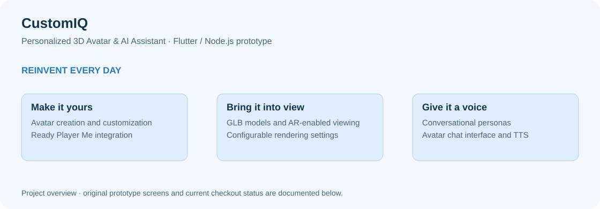
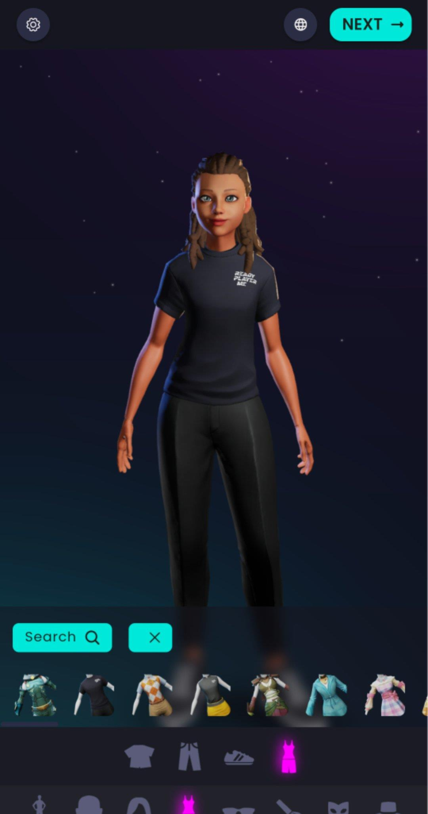
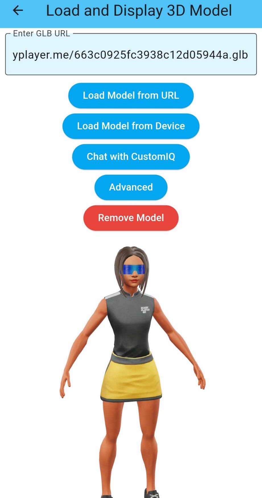
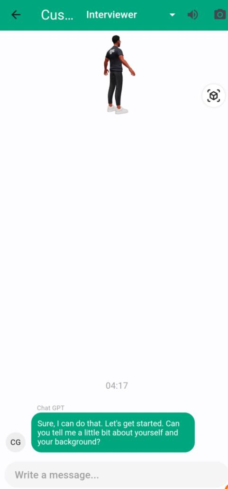
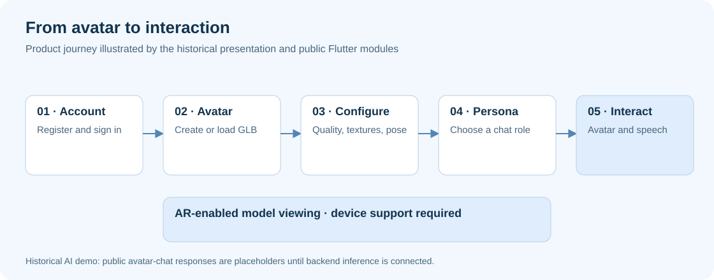
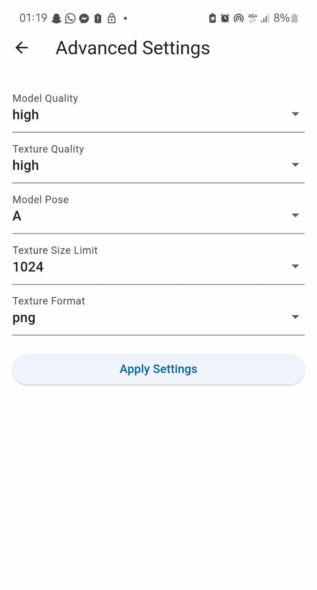
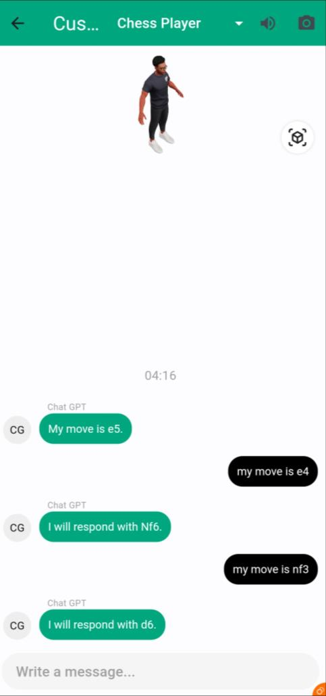
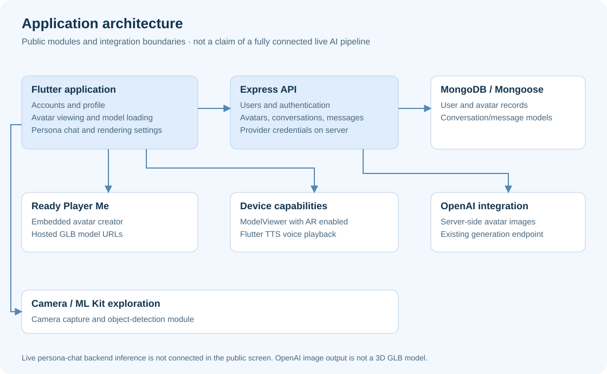

# CustomIQ — Personalized 3D Avatar & AI Assistant



CustomIQ is a Flutter and Node.js prototype combining customizable avatars, 3D model viewing, conversational personas, and voice interaction. It explores how a personal assistant can have a visual identity: users create or load an avatar, configure its model, and interact through a persona-based conversation interface.

**2024 project · Flutter / Dart · Node.js / Express · MongoDB · Ready Player Me · 3D / AR · Text-to-speech**

[Inside the application](#inside-the-application) · [Capabilities](#capabilities) · [Architecture](#architecture) · [Project status](#project-status) · [Run locally](#run-locally)

## Inside the application

<table>
<tr>
<td width="33%" valign="top"><a href="docs/assets/screens/avatar-customization.jpeg"></a><br><strong>Customize an avatar</strong><br>Give the assistant a visual identity through the embedded avatar-creation experience.</td>
<td width="33%" valign="top"><a href="docs/assets/screens/model-loader.jpeg"></a><br><strong>Load a 3D model</strong><br>Choose a hosted GLB or a model from the device, then open the avatar-chat interface.</td>
<td width="33%" valign="top"><a href="docs/assets/screens/interview-persona.jpeg"></a><br><strong>Choose a persona</strong><br>The historical demo shows role-specific conversation with an avatar visible above the messages.</td>
</tr>
</table>

Original screenshots extracted from the project's recovered presentation; click to enlarge. They document the historical interface. The current public checkout uses placeholder responses in the avatar-chat screen; see [project status](#project-status).

## The product idea

CustomIQ explored personalization across **appearance, interaction, and presentation**. An avatar creator shaped the visual identity; prompt-based personas shaped the conversation; 3D viewing and text-to-speech brought the assistant into the interface.

The engineering work spans a Flutter client, an Express API, persistent application records, an embedded avatar-creation service, model rendering, and device capabilities.

## Capabilities

| Area | What the project contains |
|---|---|
| **Avatar customization** | Ready Player Me creator embedded in a WebView, with avatar export events and hosted model URLs |
| **3D model loading** | Load a GLB from a URL or choose a local file; rotate and inspect the model with camera controls |
| **Rendering configuration** | Model quality, texture quality, A/T pose, texture-size limit, and texture format passed as model URL parameters |
| **AR-enabled viewing** | `model_viewer_plus` configured with `ar: true`; actual AR support depends on the device, platform, and model |
| **Conversational personas** | Prompt definitions for interviewer, chess player, UX/UI developer, financial analyst, and prompt generator |
| **Voice playback** | Flutter TTS with a playback toggle and speech-rate configuration; available voices/languages depend on the device |
| **Accounts and persistence** | Registration/login flows, JWT issuance, and MongoDB models/routes for users, avatars, conversations, and messages |
| **Server-side avatar images** | A separate OpenAI-backed image-generation endpoint; image output is distinct from a 3D GLB avatar |
| **Camera exploration** | Camera capture and a Google ML Kit object-detection screen |

Personas are prompt templates, not separately trained expert models. Rendering controls configure model requests; they do not automatically detect or benchmark the phone's hardware.

## From avatar to interaction



The product journey combines several modules:

1. Create an account and enter the application.
2. Customize an avatar through the embedded creator or load a GLB model.
3. Choose rendering parameters appropriate to the model and device.
4. Open the avatar-chat screen and select a conversational persona.
5. View the avatar, exchange messages, and toggle spoken output.

These describe the prototype experience. Historical AI conversations are shown in the presentation; live inference needs reconnecting in the public chat screen.

<details>
<summary><strong>More original screens: rendering controls and chess persona</strong></summary>
<p><a href="docs/assets/screens/rendering-settings.jpeg"></a> <a href="docs/assets/screens/chess-persona.jpeg"></a></p>
<p>The controls and chat screenshots were extracted directly from slides 14 and 13. Original interface content and aspect ratios are preserved.</p>
</details>

## Architecture



| Component | Responsibility | Source entry point |
|---|---|---|
| Flutter client | Navigation, accounts, profile, avatar and conversation interfaces | [frontend/lib/main.dart](frontend/lib/main.dart) |
| Avatar creator | WebView integration and model export events | [frontend/assets/iframe.html](frontend/assets/iframe.html) |
| Model viewer | GLB URL/file loading and AR-enabled display | [DisplayModelScreen.dart](frontend/lib/screens/DisplayModelScreen.dart) |
| Rendering settings | Build model-quality and texture query parameters | [AdvancedSettingsScreen.dart](frontend/lib/screens/AdvancedSettingsScreen.dart) |
| Persona chat and speech | Persona selection, message interface, and Flutter TTS | [chat_page.dart](frontend/lib/screens/chat_page.dart) |
| Express and MongoDB | Account, avatar, conversation, and message API modules | [backend/server.js](backend/server.js) |
| Avatar image provider | Server-side image generation and record persistence | [backend/controllers/avatar.js](backend/controllers/avatar.js) |
| Camera experiment | Capture images and inspect ML Kit detections | [CameraAnalysisScreen.dart](frontend/lib/screens/CameraAnalysisScreen.dart) |

The diagram maps modules and integration boundaries. It does not imply every screen is wired to every backend route. In particular, the current avatar-chat screen does not call a live inference endpoint.

## Project status

This repository preserves a historical prototype and its public portfolio version.

- **Present in source:** avatar creator integration, GLB-loading screens, configurable model parameters, AR-enabled viewers, persona definitions, TTS, account/API modules, and camera/object-detection code.
- **Historical demo evidence:** the recovered presentation shows avatar customization, model settings, and chess/interview conversations. Screenshots are not a fresh runtime acceptance test.
- **Current chat limitation:** direct mobile OpenAI calls were removed. `chat_page.dart` returns explanatory placeholders; reconnecting authenticated backend inference is follow-up implementation work.
- **Unity / VR exploration:** the presentation includes an immersive classroom scene and lists Unity, Blender, and Google AR/VR. A standalone Unity project or headset experience is not included in this repository.
- **Scope:** persistent adaptive learning, end-to-end message encryption, automatic hardware optimization, and production readiness are not claimed by this README.

See [feature evidence and visual provenance](docs/project-evidence.md) for the relationship between the presentation, public modules, and current limitations.

## Run locally

### Prerequisites

- Node.js with npm; a version supporting this repository's ES-module dependencies.
- MongoDB running locally or a MongoDB connection string.
- Flutter with a Dart SDK compatible with `>=3.3.0 <4.0.0`, plus tooling for the chosen target.

External avatar services and AR capabilities require their own connectivity/platform support. Provider-backed image generation requires a server-side key and a compatible provider/model configuration.

### 1. Backend

From the repository root:

```bash
cd backend
npm ci
```

Copy `.env.example` to `.env` (`Copy-Item .env.example .env` in PowerShell, or `cp .env.example .env` in a POSIX shell), then configure:

```dotenv
JWT_SECRET=replace-with-a-long-random-secret
DATABASE_URL=mongodb://127.0.0.1:27017/customiq
PORT=3001
HOST=127.0.0.1
OPENAI_API_KEY=replace-only-if-using-provider-backed-avatar-images
```

```bash
npm start
```

The API listens at `http://127.0.0.1:3001` with routes under `/api`. Examples include `POST /api/users`, `POST /api/users/login`, and `POST /api/avatars/generate`. Keep provider credentials in the backend environment.

### 2. Flutter client

In another terminal, from the repository root:

```bash
cd frontend
flutter pub get
flutter run --dart-define=CUSTOMIQ_API_BASE_URL=http://127.0.0.1:3001/api
```

| Target | API URL / host consideration |
|---|---|
| Same-machine desktop or browser | `http://127.0.0.1:3001/api` |
| Standard Android Studio emulator | `http://10.0.2.2:3001/api` reaches the host computer |
| Physical device on the same local network | Use the development computer's LAN address; bind the backend to a reachable interface and allow the chosen development port |

Local HTTP access and AR support also depend on the target platform's configuration. The commands configure development entry points; the complete Flutter application has not been freshly validated across targets. Existing import-casing inconsistencies may need correction on case-sensitive systems.

### Repository layout

```text
frontend/       Flutter client, embedded creator, avatar/chat and camera modules
backend/        Express routes, controllers, Mongoose models and provider integration
docs/           Feature evidence, original presentation screenshots and editable SVGs
```

## Visuals and further reading

- [Feature evidence and visual sources](docs/project-evidence.md)
- [Editable graphics generator](docs/build-visuals.py) — `python docs/build-visuals.py`
- [Frontend notes](frontend/README.md) · [Backend notes](backend/README.md)
- [Oussama Jaouadi's portfolio](https://oussamajaouadi.vercel.app)

Screenshots retain the original application interfaces. New diagrams explain the product and source structure; they are not redesigned application screens.
